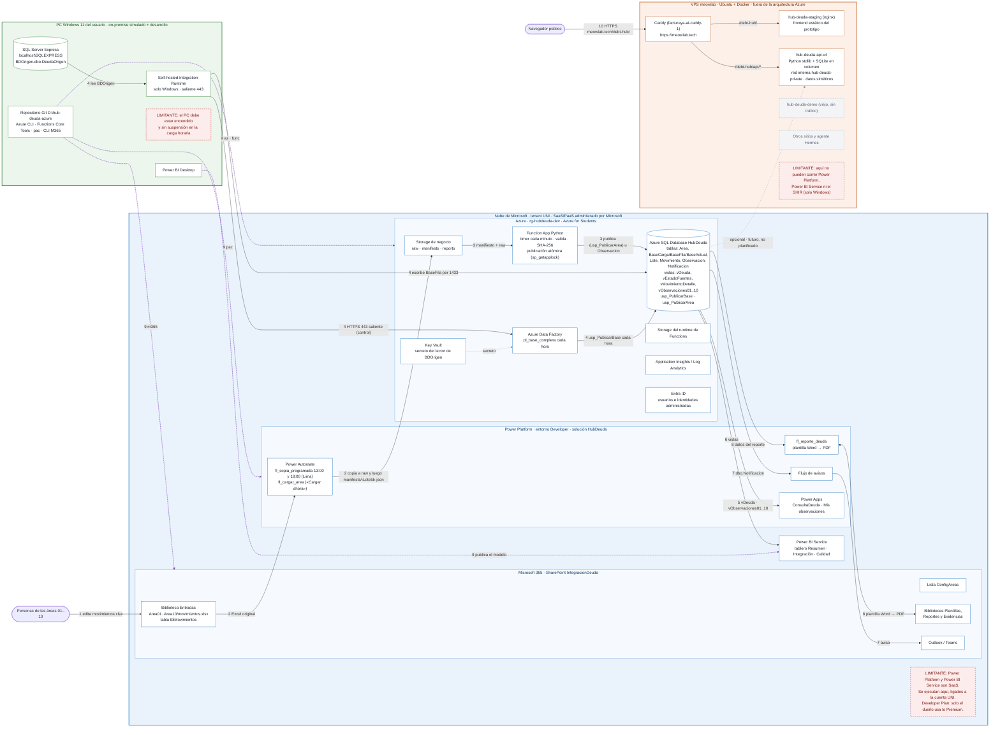

# Arquitectura final — Hub de Deuda

El Hub de Deuda se reparte en **tres infraestructuras** y cada una tiene un papel distinto:

| Infraestructura | Papel |
|---|---|
| **Nube de Microsoft** (tenant UNI: Azure + Microsoft 365 + Power Platform + Power BI Service) | Ejecuta **todo el sistema**: entrada de Excel, integración, base de datos, apps, flujos, avisos, reportes y tablero. Son servicios SaaS/PaaS que Microsoft administra en sus centros de datos; no se autoaloja nada. |
| **PC Windows 11 del usuario** | Hace de **servidor on-premise simulado** (SQL Server Express con `BDOrigen` + Self-hosted Integration Runtime) y de **estación de desarrollo** desde la que se despliega con las CLIs. |
| **VPS Linux «meowlab»** | Aloja solo el **prototipo visual** de la demostración académica previa, con datos sintéticos. **No forma parte de la arquitectura Azure** y hoy no está conectado ni a Azure ni a Power Platform. |

> **¿Power Platform puede correr en el VPS?** **No.** Power Apps, Power Automate y Power BI Service son SaaS de Microsoft: no existe un instalador para servidores propios. Sus apps y flujos se ejecutan en la nube de Microsoft, dentro del entorno ligado a la cuenta UNI. El VPS tampoco sirve para el SHIR, que solo existe para Windows.

### Versiones del diagrama

| Archivo | Qué es | Estado |
|---|---|---|
| [`arquitectura.archify.json`](arquitectura.archify.json) | **Diagrama oficial**, en formato [Archify](https://github.com/tt-a1i/archify) v3.2.0 (tipo `architecture`, `schema_version` 1): 3 regiones, flujos 1–10 en las etiquetas, flecha `dashed` para la opción futura, tarjetas con limitantes y 5 vistas guiadas | Especificación lista; falta renderizarla |
| [`arquitectura-archify.html`](arquitectura-archify.html) | HTML autocontenido que genera Archify a partir del JSON | **Todavía no existe:** se crea con el comando de abajo |
| [`arquitectura.html`](arquitectura.html) | Respaldo dibujado a mano en SVG, con leyenda y modo oscuro | Listo |

Archify no se publica en npm ni tiene librería para CDN: el HTML lo produce su CLI de Node, que hace validación, entrega, revisión estricta y una comprobación en navegador real. Para generarlo (Node 18 o superior), con una copia de Archify v3.2.0 en, por ejemplo, `D:\herramientas\archify`, se ejecuta desde `D:\hub-deuda-azure`:

```powershell
node D:\herramientas\archify\archify\bin\archify.mjs finalize architecture docs\arquitectura.archify.json docs\arquitectura-archify.html --quality showcase --json
```

Si el comando reporta cruces o etiquetas que no caben, se corrigen solo las posiciones (`pos`, `via`) en el JSON y se vuelve a ejecutar.

## 1. Diagrama

Convenciones: las flechas continuas siguen el **sentido en que viajan los datos**; las flechas punteadas moradas son **despliegue** (flujo 9, no son datos); la flecha punteada gris es la **opción futura no planificada**; las cajas rojas punteadas son **limitantes**. Cada número de flecha corresponde a la sección 4.



## 2. Qué corre dónde

| Infraestructura | Componente | Tipo | Qué hace en el hub | Flujos |
|---|---|---|---|---|
| Nube de Microsoft · Microsoft 365 | SharePoint `IntegracionDeuda`, biblioteca **Entradas** (`Area01..Area10/movimientos.xlsx`, tabla `tblMovimientos`) | SaaS | Cada área registra sus movimientos en su Excel | 1, 2 |
| Nube de Microsoft · Microsoft 365 | Lista `ConfigAreas` | SaaS | Configuración de las áreas | — |
| Nube de Microsoft · Microsoft 365 | Bibliotecas **Plantillas**, **Reportes** y **Evidencias** | SaaS | Plantilla Word, PDF generados y evidencias de pruebas | 8 |
| Nube de Microsoft · Microsoft 365 | Outlook / Teams | SaaS | Reciben los avisos | 7 |
| Nube de Microsoft · Power Platform | Power Automate `fl_copia_programada` (13:00 y 18:00, hora de Lima) y `fl_cargar_area` (botón «Cargar ahora») | SaaS | Copian el Excel original a Blob `raw` y **después** escriben el manifiesto JSON | 2 |
| Nube de Microsoft · Power Platform | Flujo de avisos | SaaS | Lee `dbo.Notificacion` y avisa por Outlook/Teams | 7 |
| Nube de Microsoft · Power Platform | `fl_reporte_deuda` | SaaS | Plantilla Word → PDF en la biblioteca Reportes | 8 |
| Nube de Microsoft · Power Platform | Power Apps `ConsultaDeuda` | SaaS | Busca por DNI/RUC, placa o papeleta sobre `vDeuda` | 5 |
| Nube de Microsoft · Power Platform | Power Apps «Mis observaciones» | SaaS | Cada área ve su vista `vObservaciones01..10` | 5 |
| Nube de Microsoft · Power Platform | Conectores Premium SQL Server y Azure Blob | SaaS | Enlazan flujos y apps con Azure | 2, 5, 7, 8 |
| Nube de Microsoft · Azure | Storage de negocio (contenedores `raw`, `manifests`, `reports`) | PaaS | Copia original del Excel y manifiestos de cada lote | 2, 3 |
| Nube de Microsoft · Azure | Storage del runtime de Functions | PaaS | Estado interno del host de Functions | — |
| Nube de Microsoft · Azure | Function App Python | PaaS | Timer cada minuto: lee manifiestos, valida el Excel, calcula SHA-256 y publica de forma atómica con `sp_getapplock` | 3 |
| Nube de Microsoft · Azure | Azure SQL Database `HubDeuda` | PaaS | Tablas `Area`, `BaseCarga`/`BaseFila`/`BaseActual`, `Lote`, `Movimiento`, `Observacion`, `Notificacion`; vistas `vDeuda`, `vEstadoFuentes`, `vMovimientoDetalle`, `vObservaciones01..10`; procedimientos `usp_PublicarBase` y `usp_PublicarArea` | 3–8 |
| Nube de Microsoft · Azure | Azure Data Factory, pipeline `pl_base_completa` | PaaS | Cada hora coordina la copia de `BDOrigen` vía SHIR y publica la deuda base | 4 |
| Nube de Microsoft · Azure | Key Vault | PaaS | Guarda el secreto del lector de `BDOrigen` | 4 |
| Nube de Microsoft · Azure | Application Insights / Log Analytics | PaaS | Telemetría y registros | — |
| Nube de Microsoft · Azure | Entra ID | SaaS | Identidades de usuarios e identidades administradas | — |
| Nube de Microsoft | Power BI Service | SaaS | Tablero Resumen, Integración y Calidad | 6, 9 |
| PC Windows 11 | SQL Server Express `localhost\SQLEXPRESS`, `BDOrigen.dbo.DeudaOrigen` | Local | Origen simulado con 3 deudas ficticias (P0001 = 100, P0002 = 250, P0003 = 80). Ya instalado y probado | 4 |
| PC Windows 11 | Self-hosted Integration Runtime (SHIR) | Servicio de Windows | Conexión **saliente** HTTPS 443 hacia ADF; escribe en Azure SQL por 1433. No publica el SQL local en Internet | 4 |
| PC Windows 11 | Repositorio Git `D:\hub-deuda-azure` (`sql/`, `functions/`, `adf/`, `powerplatform/`, `powerbi/`, `tests/`) | Archivos | Código del hub y pruebas locales del núcleo contra SQL Express | 9 |
| PC Windows 11 | Azure CLI, Azure Functions Core Tools, Power Platform CLI (`pac`), CLI for Microsoft 365 | Herramientas | Despliegue con la sesión UNI del usuario; no se comparten contraseñas | 9 |
| PC Windows 11 | Power BI Desktop | Escritorio | Construye el modelo y lo publica en Power BI Service | 9 |
| VPS meowlab | Caddy (contenedor `facturaya-ai-caddy-1`) | Contenedor | HTTPS de `meowlab.tech`; `/debt-hub/` → nginx y `/debt-hub/api/*` → API | 10 |
| VPS meowlab | `hub-deuda-staging` (nginx) | Contenedor | Frontend estático del prototipo | 10 |
| VPS meowlab | `hub-deuda-api-v4` (Python stdlib + SQLite en volumen, red Docker interna `hub-deuda-private`) | Contenedor | API del prototipo: sesiones por navegador y datos sintéticos | 10 |
| VPS meowlab | `hub-deuda-demo` | Contenedor | Versión anterior, sin tráfico | — |
| VPS meowlab | Otros sitios (`meowlab.tech`, `app.meowlab.tech`, facturaya) y agente Hermes | Contenedores | Ajenos al hub; Hermes mantiene el prototipo | — |

## 3. Limitantes y por qué

| Limitante | Por qué | Consecuencia en el diseño |
|---|---|---|
| **Power Platform no se puede instalar en el VPS** (ni en ningún servidor propio) | Power Apps y Power Automate son SaaS: Microsoft los ejecuta en su nube y cada app o flujo pertenece a un entorno del tenant UNI | Todo lo de Power Platform vive en la nube de Microsoft. El VPS no participa en el hub |
| **Power BI Service tampoco** | También es SaaS. Publicar en un workspace compartido requiere Pro, PPU o Fabric; con licencia gratuita solo existe «Mi área de trabajo» | El modelo se construye en Power BI Desktop (PC) y se publica en «Mi área de trabajo» para demostrar, no para compartir |
| **El SHIR no puede ir en el VPS** | El Self-hosted Integration Runtime solo existe para Windows y el VPS es Ubuntu | El SHIR se instala en el PC, junto a SQL Server Express |
| **El PC debe estar encendido** durante las cargas horarias | El SHIR y `BDOrigen` viven en el PC; si se apaga o suspende, ADF no puede leer el origen | La carga de esa hora falla sin dañar nada: la última base válida sigue publicada y `vEstadoFuentes` muestra el corte atrasado (pruebas T13/T14) |
| **El SQL local nunca se expone a Internet** | El SHIR inicia conexiones **salientes** (HTTPS 443 hacia ADF y 1433 hacia Azure SQL); no se abren puertos de entrada en el PC | La red del PC debe permitir la salida por 443 y 1433 |
| **Developer Plan: solo el dueño ejecuta lo Premium** | El plan gratuito es individual; los conectores SQL Server y Azure Blob son Premium | Alcanza para construir y presentar. Cada integrante que quiera usar las apps necesita su propio Developer Plan o una licencia |
| **Azure for Students limita regiones y presupuesto** | La suscripción tiene una política de regiones permitidas y un crédito de unos USD 100 | Se despliega en una región permitida, con alertas de presupuesto; al terminar el curso se apagan disparadores y se elimina `rg-hubdeuda-dev` |
| **El VPS no está conectado al hub** | Es un prototipo de demostración con datos sintéticos y está fuera del tenant UNI | Su información no es la del hub. Conectarlo es solo una opción futura (ver abajo) |

**Opción futura (no planificada):** el prototipo del VPS podría consumir, en **solo lectura**, una API o vistas del hub en Azure. Necesitaría autenticación (por ejemplo, una identidad propia con permisos mínimos) y no se implementa ahora. En el diagrama aparece como flecha punteada gris marcada «opcional».

## 4. Flujos de datos numerados

1. **Registro.** Las personas de cada área (01–10) editan `movimientos.xlsx` (tabla `tblMovimientos`) en su carpeta de la biblioteca **Entradas** de SharePoint.
2. **Copia y manifiesto.** Power Automate (`fl_copia_programada` a las 13:00 y 18:00 hora de Lima, o `fl_cargar_area` con el botón «Cargar ahora») copia el Excel original al contenedor `raw` de Blob y, después, escribe `manifests/‹LoteId›.json`.
3. **Validación y publicación por área.** La Azure Function (timer cada minuto) lee el manifiesto y el archivo de `raw`, valida el Excel, calcula SHA-256 y publica de forma atómica en Azure SQL (`sp_getapplock` + `usp_PublicarArea`). Si el archivo tiene errores, registra `Observacion` y deja el aviso en `Notificacion`.
4. **Deuda base desde el on-premise.** Cada hora, ADF (`pl_base_completa`) coordina la carga: el SHIR del PC mantiene una conexión saliente HTTPS 443 con ADF, lee `BDOrigen` en SQL Server Express, escribe la fotografía en `BaseFila` de Azure SQL por 1433 y ADF publica con `usp_PublicarBase`. La credencial del lector de `BDOrigen` sale de Key Vault.
5. **Consulta.** Power Apps lee Azure SQL con el conector SQL Server: `ConsultaDeuda` busca por DNI/RUC, placa o papeleta en `vDeuda`; «Mis observaciones» muestra `vObservaciones01..10` (cada área solo la suya).
6. **Tablero.** Power BI Service lee las vistas del hub para las páginas Resumen, Integración y Calidad.
7. **Avisos.** El flujo de avisos lee `dbo.Notificacion` y envía el aviso por Outlook o Teams.
8. **Reporte.** `fl_reporte_deuda` toma la plantilla Word de **Plantillas**, la llena con datos de las vistas del hub y guarda el PDF en **Reportes**.
9. **Despliegue (no es un flujo de datos).** Desde el PC, con la sesión UNI del usuario: `az` y `func` → Azure; `pac` → Power Platform; `m365` → SharePoint; Power BI Desktop → Power BI Service.
10. **Prototipo (independiente).** Un navegador público abre `https://meowlab.tech/debt-hub/`. Caddy envía `/debt-hub/` a `hub-deuda-staging` (nginx) y `/debt-hub/api/*` a `hub-deuda-api-v4`. Usa datos sintéticos y no toca Azure ni Power Platform.

*Opcional, futuro y no planificado:* el hub en Azure → prototipo del VPS, en solo lectura y con autenticación.
