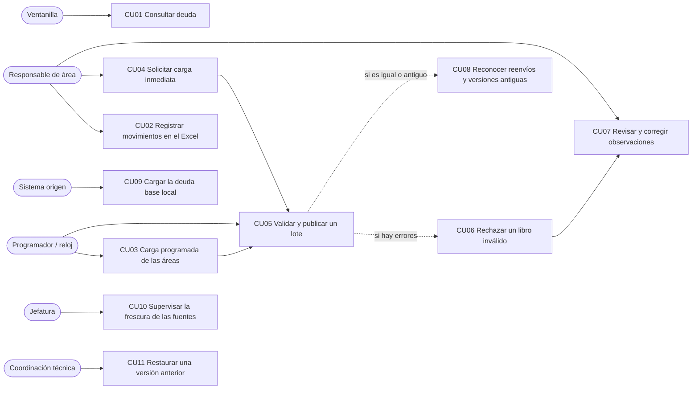
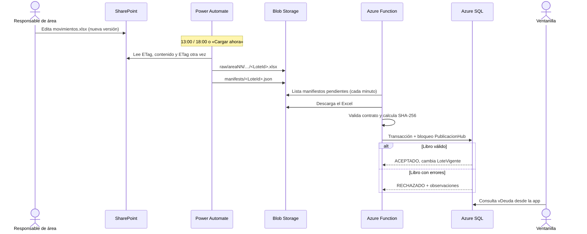

# Hub de Deuda — Casos de uso

**Fecha:** 7 de noviembre de 2026 · **Responsable:** Diogo Abregu (diogo.abregu.g@uni.pe)

Este documento describe qué hace cada actor con el Hub de Deuda y **cómo está construido cada caso de uso**: qué componente lo resuelve y en qué archivo del repositorio está. La arquitectura y el paso a paso de la construcción están en [DOCUMENTO_TECNICO.md](DOCUMENTO_TECNICO.md).

> Datos ficticios de laboratorio (curso SI806U, UNI).

---

## 1. Actores

| Actor | Quién es | Herramienta que usa |
|---|---|---|
| Responsable de área | Persona de cada una de las 10 áreas que registra movimientos | Excel en SharePoint, app «Mis observaciones» |
| Ventanilla | Personal que atiende consultas de deuda | App «Consulta de deuda» |
| Jefatura | Responsables que siguen la calidad y la frescura de los datos | Panel de fuentes de la app, tablero Power BI |
| Coordinación técnica | Quien administra Azure, SharePoint y Power Platform | Portales y scripts de `tools/` |
| Programador (reloj) | Disparadores automáticos | `fl_copia_programada` (13:00 y 18:00), timer de la Function (cada minuto, solo abre SQL si hay manifiestos nuevos), `tr_base_programada` de ADF (12:55 y 17:55) |
| Sistema origen | SQL Server local con la deuda original | Data Factory + SHIR |

## 2. Mapa de casos de uso

## 3. Flujo principal de una carga

---

## 4. Casos de uso

### CU01 — Consultar la deuda de una papeleta

| | |
|---|---|
| **Actor** | Ventanilla |
| **Objetivo** | Conocer el saldo consolidado de una papeleta y de dónde proviene |
| **Precondición** | Hay una base de deuda publicada |
| **Flujo principal** | 1. Abre «Consulta de deuda». 2. Escribe una papeleta, un DNI/RUC o una placa (mayúsculas o minúsculas). 3. La app filtra `vDeuda` en SQL (consulta delegable). 4. Elige un resultado. 5. Ve importe original, movimientos, saldo y fecha de corte, y los movimientos vigentes por área |
| **Alternos** | Sin coincidencias: «0 resultado(s)». Saldo negativo: se muestra en rojo para revisión |
| **Resultado** | Saldo con su origen y su fecha de corte; el documento aparece enmascarado (`DNI 00****01`) |
| **Cómo está construido** | App `powerplatform/apps/ConsultaDeuda/Src/Screen1.pa.yaml`; vistas `vDeuda`, `vMovimientoDetalle` (`sql/hub/002_vistas.sql`); permiso `rol_hub_consulta` |
| **Evidencia** | P0001 = S/ 75,00 y búsqueda de la placa XYZ789 (`evidencias/2026-11-07_app-consulta-*.jpg`) |

### CU02 — Registrar movimientos en el Excel del área

| | |
|---|---|
| **Actor** | Responsable de área |
| **Objetivo** | Registrar pagos, cargos, descuentos u observaciones de su área |
| **Precondición** | El área tiene su `movimientos.xlsx` en `Entradas/AreaNN` y está activa en `ConfigAreas` |
| **Flujo principal** | 1. Abre su libro en SharePoint. 2. Agrega filas en la tabla `tblMovimientos` respetando el contrato (MovimientoId, PapeletaId, Tipo, Monto, FechaEvento, Estado, Referencia, Detalle). 3. Guarda; SharePoint crea una nueva versión |
| **Alternos** | Corregir una fila: se mantiene su MovimientoId y se cambia el valor. Anular: Estado = ANULADO; nunca se borran filas |
| **Resultado** | Nueva versión del libro lista para la próxima carga |
| **Cómo está construido** | Plantillas generadas por `tools/plantillas.py` (listas desplegables por área, identificadores en formato texto); sitio creado con la API REST de SharePoint |
| **Evidencia** | Versión 2.0 de los libros de Tesorería, Ejecutoría Coactiva, Administración Tributaria y Asesoría Legal |

### CU03 — Carga programada de las áreas

| | |
|---|---|
| **Actor** | Programador (13:00 y 18:00, hora de Lima) |
| **Objetivo** | Copiar a Azure el libro vigente de cada área sin intervención |
| **Flujo principal** | 1. `fl_copia_programada` lee las áreas activas de `ConfigAreas`. 2. Para cada área, de una en una, llama a `fl_copia_area`. 3. El flujo hijo lee el ETag, el contenido y de nuevo el ETag. 4. Guarda el original en `raw/` y después el manifiesto en `manifests/`. 5. Continúa con CU05 |
| **Alternos** | El libro cambia durante la lectura: el flujo falla sin escribir nada (T15). Falla un área: las demás siguen |
| **Resultado** | Un manifiesto por área con LoteId, UniqueId, versión y fecha de modificación |
| **Cómo está construido** | `powerplatform/flows/fl_copia_programada.json` y `fl_copia_area.json`, desplegados con `tools/powerplatform.py` |
| **Evidencia** | Ejecución automática de las 13:00 del 7 nov 2026 sobre las 10 áreas |

### CU04 — Solicitar una carga inmediata («Cargar ahora»)

| | |
|---|---|
| **Actor** | Responsable de área |
| **Objetivo** | No esperar al horario programado tras corregir su libro |
| **Flujo principal** | 1. En «Mis observaciones» elige su área y pulsa **«Cargar ahora»**. 2. `fl_cargar_ahora` compara su correo con el `ResponsableUPN` del área. 3. Llama a `fl_copia_area`. 4. Responde «Carga recibida, validación pendiente» con el LoteId; la app lo muestra en un aviso y en la etiqueta «Última solicitud» |
| **Alternos** | Quien pide no es el responsable: «NO_AUTORIZADO», no se copia nada |
| **Resultado** | Lote recibido; la validación ocurre en CU05, en el minuto siguiente |
| **Cómo está construido** | `powerplatform/flows/fl_cargar_ahora.json` (disparador Power Apps V2); botón `btnCargarAhora` y etiqueta `lblCarga` en `powerplatform/apps/MisObservaciones/Src/Screen1.pa.yaml` |
| **Estado** | Funcionando (7 nov 2026): Tesorería → lote `02ff35c9` RECIBIDO y ACEPTADO por la Function en menos de 1 minuto, sin observaciones y sin cambiar saldos |
| **Evidencia** | `evidencias/2026-11-07_app-observaciones-cargar-ahora-RECIBIDO.jpg` |

### CU05 — Validar y publicar un lote

| | |
|---|---|
| **Actor** | Programador (timer de la Function, cada minuto) |
| **Objetivo** | Convertir un Excel recibido en movimientos vigentes sin duplicar ni publicar datos parciales |
| **Flujo principal** | 1. Lista los manifiestos pendientes. 2. Valida el manifiesto y que el archivo sea el autorizado del área. 3. Descarga el Excel, calcula SHA-256 y valida cada fila. 4. Abre una transacción y toma el bloqueo `PublicacionHub`. 5. Inserta lote y movimientos y ejecuta `usp_PublicarArea`. 6. Confirma lote, aviso y marca terminal en la misma transacción |
| **Alternos** | Errores → CU06. Mismo contenido o versión antigua → CU08. Fallo técnico → reintento con espera de 1 a 60 minutos, sin marcar el archivo como inválido |
| **Resultado** | Lote ACEPTADO; el saldo cambia de una sola vez |
| **Cómo está construido** | `functions/procesador.py`, `validacion.py`, `repositorio_sql.py`; procedimiento en `sql/hub/003_procedimientos.sql` |
| **Evidencia** | Tesorería PAGO 30 → P0001 = 70; cargo 15 y descuento 10 → P0001 = 75, total 405; luego Tesorería agregó `TES0002` (PAGO 50 a P0002) → total 355 |

### CU06 — Rechazar un libro inválido

| | |
|---|---|
| **Actor** | Programador (Function) |
| **Objetivo** | Que un archivo con errores no altere el saldo vigente |
| **Flujo principal** | 1. La validación encuentra errores. 2. Se registra el lote como RECHAZADO con una observación por fila, campo y código. 3. Se encola un aviso para el área. 4. La versión anterior sigue vigente |
| **Alternos** | Libro vacío: CARGA_VACIA. Se omite un movimiento anterior: rechazo por pérdida de historia (`PUBLICACION_50107`) |
| **Resultado** | Saldo intacto y observaciones disponibles para CU07 |
| **Cómo está construido** | Códigos de error en `functions/validacion.py`; reglas finales en `usp_PublicarArea` |
| **Evidencia** | Asesoría Legal: OBSERVACION con monto 5 → MONTO_INVALIDO en la fila 3; P0002 se mantuvo en 250 |

### CU07 — Revisar y corregir observaciones

| | |
|---|---|
| **Actor** | Responsable de área |
| **Objetivo** | Saber qué fila falló y corregirla en el origen |
| **Flujo principal** | 1. Abre «Mis observaciones» y elige su área. 2. Ve fila, campo, código, mensaje, lote y fecha. 3. Pulsa «Abrir carpeta del área» y corrige el libro manteniendo el MovimientoId. 4. Se ejecuta una nueva carga (CU03 o CU04). 5. Al aceptarse, las observaciones anteriores quedan **subsanadas**, no borradas |
| **Alternos** | Elige otra área sin permiso: la app avisa «No tiene permiso» (en producción cada área lee solo su vista) |
| **Resultado** | Historial de errores con su estado pendiente o subsanado |
| **Cómo está construido** | `powerplatform/apps/MisObservaciones/Src/Screen1.pa.yaml`; vistas `vObservaciones01…10` y columna `SubsanadaPor` (`sql/hub/004_seguridad.sql`, `003_procedimientos.sql`) |
| **Evidencia** | Asesoría Legal con 2 pendientes; Ejecutoría Coactiva con 1 subsanada (`evidencias/2026-11-07_app-observaciones-*.jpg`) |

### CU08 — Reconocer reenvíos y versiones antiguas

| | |
|---|---|
| **Actor** | Programador (Function) |
| **Objetivo** | Que repetir una carga no duplique saldos ni deje que gane una versión vieja |
| **Flujo principal** | 1. Compara el SHA-256, el archivo y la versión de reglas con el lote vigente. 2. Igual → SIN_CAMBIOS (cuenta como verificación). 3. Fecha anterior → OBSOLETO. 4. Misma fecha con otro contenido o igual a una versión histórica → CONFLICTO |
| **Resultado** | Ningún cambio en el saldo; la fuente aparece como verificada |
| **Cómo está construido** | Función `decidir` en `functions/procesador.py` |
| **Evidencia** | La copia de las 13:00 reenvió el libro de Tesorería → SIN_CAMBIOS (T03); T10 en las pruebas locales |

### CU09 — Cargar la deuda base desde el sistema local

| | |
|---|---|
| **Actor** | Sistema origen (Data Factory a las 12:55 y 17:55 de Lima; la guía propone cada hora, se redujo para que Azure SQL pueda pausarse) |
| **Objetivo** | Traer la deuda original sin publicar SQL local en Internet |
| **Flujo principal** | 1. `usp_CrearExportacion` toma una fotografía consistente en BDOrigen. 2. `usp_IniciarBaseCarga` registra la carga. 3. Copy escribe `BaseFila` con el RunId. 4. `usp_PublicarBase` valida conteo, documentos y que no falten papeletas con movimientos, y cambia el puntero |
| **Alternos** | Falla la copia o la validación: la carga queda FALLIDA y la base anterior sigue vigente |
| **Cómo está construido** | `adf/pipeline/pl_base_completa.json`, `sql/origen/002_exportacion.sql`, `tools/instalar_shir.ps1` |
| **Estado** | Publicado; falta instalar el SHIR. La base actual se cargó con `tools/cargar_base_directa_azure.py` (mismos procedimientos, sin SHIR) |

### CU10 — Supervisar la frescura de las fuentes

| | |
|---|---|
| **Actor** | Jefatura |
| **Objetivo** | Saber si la consulta refleja cargas recientes y qué áreas tienen problemas |
| **Flujo principal** | 1. Revisa el panel «Estado de las fuentes» en «Consulta de deuda». 2. Ve el corte de la base y, por área, la versión aceptada, la última verificación y el último intento. 3. Las áreas con rechazos aparecen en rojo |
| **Resultado** | Visibilidad del corte por fuente; el hub no se presenta como tiempo real |
| **Cómo está construido** | Vista `vEstadoFuentes`; tablero Power BI en `powerbi/` (páginas Resumen, Integración y Calidad) |
| **Estado** | Panel en la app funcionando; Power BI pendiente de abrir y publicar |

### CU11 — Restaurar una versión anterior

| | |
|---|---|
| **Actor** | Coordinación técnica |
| **Objetivo** | Volver a una versión aceptada de un área ante un lote erróneo |
| **Flujo principal** | 1. Ejecuta `usp_RestaurarLoteVigente` con el área, el LoteId y un motivo de al menos 10 caracteres. 2. El procedimiento verifica que el lote fue aceptado y que sus papeletas existen. 3. Cambia el puntero y registra el cambio en `CambioPuntero` |
| **Resultado** | Saldo recalculado con la versión elegida y auditoría del cambio |
| **Cómo está construido** | `sql/hub/003_procedimientos.sql` |

---

### CU12 — Cargar un libro de 500 000 filas

| | |
|---|---|
| **Actor** | Un área con mucho historial (por ejemplo Tesorería), a través del worker |
| **Cuándo ocurre** | (a) Carga inicial o histórica: el Excel acumulado de un área entra de una vez. (b) Reenvío de un libro grande: cada archivo es el estado completo del área, así que cualquier cambio reprocesa el libro entero |
| **Precondición** | Archivo autorizado y registrado para el área; deuda base vigente; worker encendido; unos 8 GB de RAM libres (el proceso llega a 2,6 GB) |
| **Flujo principal** | 1. El área guarda su Excel (≈ 16 MiB) en su carpeta. 2. El worker detecta el cambio por su huella SHA-256 y guarda el original. 3. Lee el libro en flujo, lo traduce al modelo común, sanea y registra cada corrección (≈ 2 min). 4. El validador revisa **todas** las filas y, si no hay errores, hace la carga masiva y publica el lote moviendo el puntero (≈ 1,5 min). 5. Las apps pasan a mostrar los datos nuevos de una sola vez (≈ 3,4 min desde que se guardó el archivo). 6. El worker guarda en SQL el registro de correcciones por tandas de 20 000 filas (≈ 3,7 min; no bloquea las consultas) |
| **Alternos** | Un solo error (por ejemplo un monto ilegible en la fila 490 000) → CU06: se rechaza el archivo completo en ≈ 3,4 min, con la lista completa de errores, y la base queda intacta. Mismo archivo otra vez → CU08 (SIN_CAMBIOS). |
| **Resultado** | 500 000 movimientos vigentes y un lote ACEPTADO, o el lote RECHAZADO con sus observaciones en «Mis observaciones» (CU07) |
| **Métricas medidas** | Excel «sucio» de 500 000 filas → publicado: 205 s; total con el registro de correcciones: 428 s (≈ 7,1 min); 1 583 333 correcciones; memoria máxima 2,6 GB; consulta de saldo de una papeleta con el volumen cargado: ≈ 159 ms. Con el libro ya limpio en formato común: 130 s |
| **Cómo está construido** | `onprem/worker.py` y `mapeo.py` (etapa 1), `functions/procesador.py` y `validacion.py` (etapa 2), `worker.guardar_correcciones` (etapa 3); límites ampliados con `HUB_MAX_BYTES` y `HUB_MAX_EXPANDIDO` |
| **Evidencia** | `tests/test_volumen_worker.py`, `tools/demo_500k.py`, `docs/PRUEBA_VOLUMEN.md` y `docs/DEMO_500K.md`; `evidencias/2026-11-14_prueba-volumen-worker-500000.txt` |
| **Limitaciones** | No hay carga incremental (cambiar una celda de un libro grande cuesta reprocesarlo entero). No se midió la carga de varias áreas grandes a la vez, el tamaño final en disco, qué ocurre si falta memoria ni Excel reales con fórmulas |

## 5. Estado de los casos de uso

| Caso | Estado |
|---|---|
| CU01, CU02, CU03, CU04, CU05, CU06, CU07, CU08 | Funcionando y verificados en Azure |
| CU09 | Publicado; falta instalar el SHIR en el PC |
| CU10 | Funcionando en la app; Power BI pendiente de publicar |
| CU11 | Implementado y probado en local |
| CU12 | Funcionando y medido en la versión on-premise (500 000 filas) |

## 6. Enlaces de acceso

| Qué | Enlace |
|---|---|
| App «Consulta de deuda» (CU01, CU10) | [Abrir](https://apps.powerapps.com/play/e/ac29d72f-46e6-e8e5-b3ae-7af14ca530ec/a/75dd0101-3dbd-477e-b9e2-8ec92a648421?tenantId=1eba443f-23e5-4534-90d1-0976aabe86ac) |
| App «Mis observaciones» (CU07) | [Abrir](https://apps.powerapps.com/play/e/ac29d72f-46e6-e8e5-b3ae-7af14ca530ec/a/7b69dbaa-07b5-4e50-939a-2bfd66da2b3f?tenantId=1eba443f-23e5-4534-90d1-0976aabe86ac) |
| Solución «Hub de Deuda» (apps y flujos) | [Abrir](https://make.powerapps.com/environments/ac29d72f-46e6-e8e5-b3ae-7af14ca530ec/solutions/0dc75ac9-c1da-f111-84e8-002248e011c9) |
| Flujo `fl_copia_area` (CU03, CU04) | [Abrir](https://make.powerautomate.com/environments/ac29d72f-46e6-e8e5-b3ae-7af14ca530ec/flows/9d27512f-261f-caba-1232-85282eae0b2c/details) |
| Flujo `fl_copia_programada` (CU03) | [Abrir](https://make.powerautomate.com/environments/ac29d72f-46e6-e8e5-b3ae-7af14ca530ec/flows/a8dc79ec-c7f0-f039-2ac5-0feb8d7b5f69/details) |
| Sitio SharePoint (CU02) | [Abrir](https://unipe.sharepoint.com/sites/IntegracionDeuda) |
