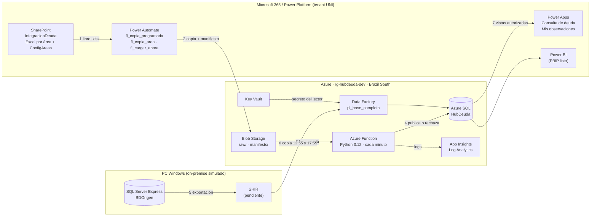

# Hub de Deuda — Documento técnico

**Fecha:** 7 de noviembre de 2026 · **Responsable:** Diogo Abregu (diogo.abregu.g@uni.pe) · **Curso:** SI806U Desarrollo Adaptativo e Integración de Software (UNI)

El Hub de Deuda integra la deuda original de un SQL Server local con los movimientos que diez áreas registran en Excel, y publica en Azure SQL un saldo consolidado por papeleta. Está desplegado en la nube de Microsoft con la cuenta UNI y funciona de punta a punta con datos ficticios: P0001 pasa de S/ 100,00 a S/ 75,00 con movimientos de tres áreas.

Este documento describe **cómo está construido** (secciones 1 a 8) y **cómo se construyó, paso a paso** (sección 9). Los casos de uso están en [CASOS_DE_USO.md](CASOS_DE_USO.md).

> Todos los datos son ficticios. El sistema es un laboratorio académico, no un sistema productivo.

---

## 1. Alcance

| Implementado y verificado | Pendiente |
|---|---|
| Base de datos del hub en Azure SQL con publicación atómica e idempotente | Instalar el SHIR en el PC y cargar la base por Data Factory |
| Azure Function (Python) que valida cada Excel y publica o rechaza el lote | Flujo de avisos por correo (la cola `Notificacion` ya se llena) |
| SharePoint con 10 carpetas de área, plantillas y lista `ConfigAreas` | Reporte PDF con plantilla Word |
| Flujos de Power Automate: copia 13:00/18:00, copia por área y «Cargar ahora» | Abrir y publicar el tablero Power BI (código listo en `powerbi/`) |
| Apps «Consulta de deuda» y «Mis observaciones» | Pruebas T05–T15 en Azure y prueba T12 con una segunda cuenta |
| Data Factory publicado (pipeline, conexiones, runtime) | Permisos por carpeta de área en SharePoint |
| 14 pruebas automatizadas y pruebas de punta a punta en Azure | |

---

## 2. Arquitectura

### Qué corre dónde

| Lugar | Componente | Nombre real | Función |
|---|---|---|---|
| Azure | Grupo de recursos | `rg-hubdeuda-dev` (brazilsouth) | Contiene todo lo de Azure |
| Azure | Storage de negocio | `sthubdeudadevdg23ne` | Contenedores `raw`, `manifests`, `reports`; versionado y borrado temporal |
| Azure | Storage del runtime | `sthubfuncdevdg23ne` | Almacenamiento y despliegue de la Function |
| Azure | Azure SQL | `sql-hubdeuda-dev-dg23ne` / `HubDeuda` | Hub de datos; solo autenticación Entra; serverless con oferta gratuita |
| Azure | Function App | `func-hubdeuda-dev-dg23ne` | Flex Consumption, Python 3.12, identidad administrada |
| Azure | Data Factory | `adf-hubdeuda-dev-dg23ne` | Pipeline `pl_base_completa`, runtime `ir-onpremise` |
| Azure | Key Vault | `kv-hubdeuda-dg23ne` | Secreto `bdorigen-lector` (contraseña del lector local) |
| Azure | Monitoreo y costos | `appi-hubdeuda-dev`, `log-hubdeuda-dev`, `budget-hubdeuda-dev` | Trazas y alertas al 50/80/100 % de USD 20 |
| Microsoft 365 | SharePoint | `https://unipe.sharepoint.com/sites/IntegracionDeuda` | Bibliotecas Entradas, Plantillas, Reportes, Evidencias; lista ConfigAreas |
| Power Platform | Entorno Developer | `https://org2535ee74.crm2.dynamics.com/` | Solución `HubDeuda`: 3 flujos, 2 apps, 4 referencias de conexión |
| PC Windows | SQL Server Express | `localhost\SQLEXPRESS` / `BDOrigen` | Deuda original (3 papeletas ficticias) |
| PC Windows | Self-hosted IR | `ir-onpremise` | Conexión saliente de ADF al SQL local (pendiente de instalar) |
| VPS meowlab | Prototipo previo | `meowlab.tech/debt-hub` | Demostración anterior, independiente de Azure |

Power Apps, Power Automate y Power BI son servicios de Microsoft: se ejecutan en sus centros de datos, no en el VPS ni en el PC. El SHIR necesita Windows, por eso va en el PC.

---

## 3. Modelo de datos (Azure SQL)

El hub guarda versiones históricas y publica cambiando un **puntero** dentro de una transacción breve, así nunca muestra una carga a medio procesar. Se crea con migraciones numeradas en `sql/hub/` que aplica `tools/aplicar_sql.py`; una migración aplicada no se edita: se agrega otra.

| Objeto | Tipo | Responsabilidad |
|---|---|---|
| `Area` | Tabla | Catálogo de 10 áreas, tipo económico permitido y `LoteVigente` |
| `AreaFuente` | Tabla | Archivo autorizado por área (UniqueId de SharePoint) |
| `BaseCarga`, `BaseFila`, `BaseActual` | Tablas | Fotografías de la deuda original y puntero a la vigente |
| `Lote`, `Movimiento`, `Observacion` | Tablas | Cada Excel recibido, sus filas válidas y sus errores |
| `Notificacion` | Tabla | Cola de avisos por lote (clave única `LoteId + TipoAviso`) |
| `ProcesoManifiesto` | Tabla | Intentos, último error y próximo reintento por manifiesto |
| `CambioPuntero` | Tabla | Auditoría de restauraciones manuales |
| `vDeuda` | Vista | Una fila por papeleta con saldo y documento enmascarado |
| `vMovimientoDetalle`, `vEstadoFuentes` | Vistas | Movimientos vigentes por área y fecha de corte de cada fuente |
| `vObservaciones01`…`10` | Vistas | Observaciones de un área (cada rol de área lee solo la suya) |
| `vLoteCalidad`, `vObservacionCalidad` | Vistas | Métricas para Power BI |
| `usp_PublicarBase`, `usp_PublicarArea` | Procedimientos | Validan y cambian el puntero bajo el bloqueo `PublicacionHub` |

**Regla del saldo:** Saldo = ImporteOriginal + movimientos activos con signo. PAGO y DESCUENTO restan, CARGO suma, OBSERVACION vale cero, ANULADO no cuenta. Un saldo negativo se muestra y se marca `RequiereRevision`.

| Estado del lote | Cuándo | Efecto en el saldo |
|---|---|---|
| ACEPTADO | Libro válido y más nuevo que el vigente | Pasa a ser la versión vigente del área |
| RECHAZADO | Alguna fila o el archivo es inválido | Ninguno; quedan las observaciones |
| SIN_CAMBIOS | Mismo archivo y contenido que el vigente | Ninguno; cuenta como verificación |
| OBSOLETO | Versión más antigua que la vigente | Ninguno |
| CONFLICTO | Misma fecha con otro contenido, o idéntico a una versión histórica | Ninguno; requiere revisión |

El detalle de columnas está en [DICCIONARIO_DATOS.md](DICCIONARIO_DATOS.md).

---

## 4. Procesamiento de los Excel (Azure Function)

La Function `ingestar` (`functions/function_app.py`) se ejecuta cada minuto y procesa hasta 20 manifiestos pendientes. Cada manifiesto se procesa aislado: un archivo defectuoso no bloquea a las otras áreas.

### Contrato del Excel

Hoja `Datos`, tabla `tblMovimientos`, columnas en este orden: `MovimientoId`, `PapeletaId`, `Tipo`, `Monto`, `FechaEvento`, `Estado`, `Referencia`, `Detalle`. El validador (`functions/validacion.py`) rechaza encabezados distintos, fórmulas, identificadores duplicados, papeletas inexistentes, tipos no autorizados para el área, montos inválidos, fechas futuras, referencias económicas repetidas y libros vacíos. Cada error se guarda con fila, campo, código y mensaje.

### Secuencia de un manifiesto (`functions/procesador.py`)

1. **Leer el manifiesto** y validar `loteId`, `areaId`, versión del contrato y que `rawPath` pertenezca a la carpeta del área.
2. **Preparar fuera de la transacción:** leer la configuración del área y las papeletas vigentes, descargar el Excel, calcular su SHA-256 y validarlo.
3. **Abrir la transacción** y tomar el bloqueo `sp_getapplock('PublicacionHub')`.
4. **Resolver repeticiones:** si el `LoteId` ya terminó, no hace nada (idempotencia).
5. **Decidir el estado:** archivo no autorizado → RECHAZADO; mismo hash que el vigente → SIN_CAMBIOS; versión anterior → OBSOLETO; misma fecha con otro contenido → CONFLICTO; errores de validación → RECHAZADO.
6. **Publicar** si todo es válido: insertar lote y movimientos y ejecutar `usp_PublicarArea`, que revalida bajo el bloqueo (papeletas, movimientos omitidos, tipos) y mueve el puntero.
7. **Confirmar** en una sola transacción: lote, observaciones, aviso en `Notificacion` y marca terminal del manifiesto.

Un **fallo técnico** (red, bloqueo, base no disponible) no se registra como archivo inválido: se deshace todo y se reintenta con espera exponencial de 1 a 60 minutos. Si la Function cae antes del commit no queda nada escrito; si cae después, el reintento reconoce el lote terminal y no cambia el saldo (prueba T11).

---

## 5. Integraciones

### SharePoint

- Biblioteca `Entradas` con carpetas `Area01`…`Area10`, cada una con su `movimientos.xlsx` (historial de versiones activo).
- Lista `ConfigAreas`: AreaId, NombreArea, RutaArchivo, **FileUniqueId**, Activa, ResponsableUPN, VersionContrato, DestinoAvisos.
- El UniqueId de cada libro se copia a `dbo.AreaFuente` (`tools/sincronizar_areafuente.py`); la Function rechaza cualquier otro archivo.

### Power Automate (solución `HubDeuda`)

| Flujo | Disparador | Qué hace |
|---|---|---|
| `fl_copia_area` (hijo) | Manual / llamado por otros flujos | Lee `ConfigAreas`, lee el ETag del libro, descarga el contenido, vuelve a leer el ETag; si cambió, falla sin escribir (T15). Guarda `raw/areaNN/AAAA/MM/DD/<LoteId>.xlsx` y **después** `manifests/<LoteId>.json` |
| `fl_copia_programada` | Diario 13:00 y 18:00 (hora de Lima) | Recorre las áreas activas una por una y llama al hijo |
| `fl_cargar_ahora` | Power Apps (V2) | Verifica que quien pide sea el `ResponsableUPN` del área y llama al hijo; devuelve LoteId y «Carga recibida, validación pendiente» |

Los flujos están versionados como JSON en `powerplatform/flows/` y se despliegan con `tools/powerplatform.py` mediante la API web de Dataverse.

### Data Factory (base on-premise)

Pipeline `pl_base_completa`: `usp_CrearExportacion` en BDOrigen (conteo, corte y filas de la misma fotografía) → `usp_IniciarBaseCarga` → copia a `BaseFila` con `CargaId = RunId` → `usp_PublicarBase`. Si la copia o la publicación fallan, marca la carga `FALLIDA` y la base anterior sigue vigente. El disparador `tr_base_programada` corre a las 12:55 y 17:55 de Lima, justo antes de las cargas de Excel; la guía propone cada hora, pero así Azure SQL puede pausarse (sección 10). Está detenido hasta tener el SHIR instalado. Mientras tanto la base se cargó con `tools/cargar_base_directa_azure.py`, que usa los mismos procedimientos.

---

## 6. Aplicaciones (Power Apps)

| App | Datos | Qué permite |
|---|---|---|
| Consulta de deuda | `vDeuda`, `vMovimientoDetalle`, `vEstadoFuentes` | Buscar por papeleta, DNI/RUC o placa; ver saldo, documento enmascarado, movimientos por área y fecha de corte de cada fuente |
| Mis observaciones | `vObservaciones01`…`10` | Elegir el área, ver errores pendientes y subsanados, abrir la carpeta del área en SharePoint |

Las dos son **apps de lienzo escritas como código** (`powerplatform/apps/<App>/Src/Screen1.pa.yaml`). `tools/publicar_apps.ps1` las empaqueta con `pac canvas pack`, las inserta en la solución exportada y la vuelve a importar.

---

## 7. Seguridad

- **Sin contraseñas en el código:** Azure SQL acepta solo Microsoft Entra; Function y ADF usan identidades administradas; la única contraseña (lector de BDOrigen) se genera y va directa a Key Vault.
- **Permisos mínimos por rol de base de datos:** `rol_hub_integracion` (Function), `rol_hub_ingesta_base` (ADF), `rol_hub_consulta` (ventanilla), `rol_hub_area01`…`10` (cada área ve solo su vista), `rol_hub_bi`, `rol_hub_avisos`.
- **Almacenamiento:** contenedores privados, TLS 1.2, la Function solo lee el negocio.
- **Red:** regla de firewall para la IP del PC (`tools/actualizar_ip_pc.ps1` la actualiza) y «Permitir servicios de Azure» para Functions sin VNet y conectores de Power Platform (limitación aceptada del laboratorio).
- **Datos personales:** las apps muestran el documento enmascarado; los registros solo usan identificadores técnicos.

Matriz completa en [MATRIZ_PERMISOS.md](MATRIZ_PERMISOS.md).

---

## 8. Despliegue, operación y pruebas

| Herramienta | Uso |
|---|---|
| `infra/main.bicep` | Toda la infraestructura de Azure (`az deployment group create`) |
| `tools/aplicar_sql.py`, `tools/desplegar_sql_azure.py` | Migraciones locales y en Azure; usuarios de identidades administradas |
| `func azure functionapp publish func-hubdeuda-dev-dg23ne` | Publicar la Function (compilación remota) |
| `tools/desplegar_adf.ps1`, `tools/ejecutar_pipeline_base.ps1` | Publicar ADF y ejecutar la carga base |
| `tools/powerplatform.py desplegar \| enlazar \| activar` | Solución, referencias de conexión y flujos |
| `tools/publicar_apps.ps1` | Apps desde su código `pa.yaml` |
| `tools/instalar_shir.ps1` | SHIR, modo mixto de SQL Express y lector en Key Vault (lo ejecuta el usuario como administrador) |
| `tools/prueba_humo_azure.py`, `tools/reiniciar_datos_hub.py` | Prueba de punta a punta y limpieza de datos de prueba |

**Costo estimado:** del orden de USD 10 al mes; presupuesto de USD 20 con alertas. Al terminar el curso hay que eliminar `rg-hubdeuda-dev`.

**Pruebas:** 14/14 en local (`pytest`, contra SQL Express); en Azure se verificaron T01, T02, T03 y el rechazo de un libro inválido. Detalle en [PRUEBAS.md](PRUEBAS.md) y capturas en `evidencias/`.

---

## 9. Cómo se construyó, paso a paso

1. **Lectura de los documentos de la cátedra.** Se extrajo el texto del informe y de la guía (86 000 caracteres) y se definió el alcance: guía completa con datos ficticios.
2. **Decisiones de cuenta y licencias.** Cuenta UNI (`diogo.abregu.g@uni.pe`), suscripción de pago por uso (la cuenta no tenía Azure for Students) y Power Apps Developer Plan.
3. **Repositorio y accesos.** Se creó `D:\hub-deuda-azure` y `docs/ACCESOS.md` con lo que debía hacer el usuario (inicios de sesión) y lo que haría el agente.
4. **Modelo SQL.** Se escribieron las migraciones a partir del Anexo A, completando lo que la guía dejaba abierto: tabla de archivo autorizado, cola de avisos, control de reintentos, 10 vistas por área y roles.
5. **Function en Python.** Validador (Anexo B), persistencia con transacción explícita y bloqueo (Anexo C) y decisión de estados.
6. **Pruebas locales primero.** Se probó T01–T12 contra el SQL Server Express del PC antes de tocar Azure: 12/12, luego 14/14 con las pruebas de permisos mínimos.
7. **Herramientas.** Se instalaron Azure CLI, Functions Core Tools, CLI for Microsoft 365, .NET 10 (requerido por Power Platform CLI) y Bicep, con permiso explícito para cada descarga.
8. **Infraestructura.** `infra/main.bicep` se desplegó en Brazil South en unos 4 minutos.
9. **Base de datos y Function en Azure.** Se aplicaron las migraciones con la sesión de `az login`, se crearon los usuarios de las identidades administradas y se publicó la Function.
10. **Prueba de humo.** Detectó que el rol de la Function no podía leer `Notificacion` (error 229). Se corrigió con la migración `005` y se agregó una prueba que ejecuta el procesador con permisos mínimos. Al reintentar, P0001 quedó en 70.
11. **Data Factory.** Se publicaron conexiones, conjuntos de datos, pipeline y disparador. El runtime tuvo que llamarse `ir-onpremise` (ADF no acepta `_`).
12. **SharePoint.** `m365` exigía registrar una aplicación en el tenant UNI, así que el sitio, las bibliotecas, las carpetas, las 10 plantillas y `ConfigAreas` se crearon con la API REST de SharePoint desde Chrome, con la sesión del usuario.
13. **Power Automate.** Los flujos se escribieron como JSON y se crearon con la API de Dataverse. El usuario autorizó las 4 conexiones (SharePoint, Azure Blob, SQL y Outlook, con Entra ID) y luego se enlazaron y encendieron por script.
14. **Primer corte vertical real.** Se subió la versión 2 del Excel de Tesorería (PAGO 30), se ejecutó el flujo y la Function publicó: P0001 = 70, total 400.
15. **Copia programada.** La ejecución de las 13:00 recorrió las 10 áreas: Tesorería quedó SIN_CAMBIOS (T03) y las plantillas vacías se rechazaron por CARGA_VACIA.
16. **Datos de demostración.** Cargo de 15 (área 02), descuento de 10 (área 07) y un libro con error (área 03): P0001 = 75, total 405, y el libro inválido rechazado con MONTO_INVALIDO.
17. **Apps como código.** Se creó cada app vacía con sus orígenes de datos, se descargó con `pac`, se escribió su pantalla en `pa.yaml`, se empaquetó y se publicó en la solución. Se resolvieron dos problemas: el bloqueo de edición de Power Apps y las rutas con `\` al recomprimir el zip.
18. **Documentación y Power BI en paralelo.** Dos subagentes generaron el diccionario de datos, la matriz de permisos, el registro de decisiones, el estado de pruebas y el proyecto PBIP.
19. **Commit.** Todo se confirmó en git (`2004c`) tras revisar que no hubiera secretos; los archivos con datos de la cuenta quedaron ignorados.
20. **Ahorro de la oferta gratuita de SQL.** La revisión detectó que la Function mantenía la base siempre encendida (1 conexión por minuto en la métrica). Se agregó la marca de estado en los metadatos de cada manifiesto, permiso de escritura solo en el contenedor `manifests` y la carga base dos veces al día; 17/17 pruebas locales.

### Problemas encontrados y cómo se resolvieron

| Problema | Causa | Solución |
|---|---|---|
| Error 4083 en pruebas | El pool ODBC reutilizaba conexiones a bases recreadas | `pyodbc.pooling = False` en las pruebas |
| Function sin procesar lotes | Faltaba `SELECT` en `Notificacion` | Migración `005` + prueba con permisos mínimos |
| SQL rechaza al PC | La IP pública cambió tras un reinicio | `tools/actualizar_ip_pc.ps1` |
| `pac` no instala | Requiere .NET 10 | SDK de .NET 10 a nivel de usuario |
| `m365 login` bloqueado | Exige registrar una app en el tenant | API REST de SharePoint desde el navegador |
| App «bloqueada» | Studio deja la app reservada al cerrarse mal | Salir con «Atrás» y esperar unos minutos |
| Importación de la solución falla | .NET Framework escribe rutas con `\` en el zip | Reemplazar solo las entradas `.msapp` dentro del zip original |
| App en blanco | Propiedad `Value` no válida en el desplegable clásico | Lista simple de nombres |
| Azure SQL nunca se pausaba | La Function consultaba SQL cada minuto aunque no hubiera trabajo | Estado del manifiesto en metadatos de Blob; SQL solo con manifiestos nuevos |

---

## 10. Riesgos y limitaciones conocidas

- **Consumo de la oferta gratuita de Azure SQL (corregido el 7 nov 2026).** La Function abría SQL cada minuto mientras existiera algún manifiesto, y la base nunca se pausaba: la oferta gratuita (100 000 vCore-segundos al mes, unas 55 h a 0.5 vCore) se habría agotado en unos 2 días. Ahora la Function marca cada manifiesto en sus metadatos de Blob (`hd_estado=terminal` o `hd_proximo=<reintento>`) y **no abre SQL si no hay manifiestos nuevos** (pruebas `tests/test_sin_consultas.py`). Además, la carga base de ADF pasó de cada hora a 12:55 y 17:55. Azure no permite bajar la pausa automática de 60 minutos en una base de oferta gratuita que se pausa al agotarla, así que cada carga mantiene la base encendida unos 60 minutos: con dos ventanas al día el consumo queda cerca del límite mensual, y el uso intensivo de las apps lo suma. Se vigila con la métrica `free_amount_remaining`.
- Cada copia programada crea un lote RECHAZADO (CARGA_VACIA) y un aviso por cada área con plantilla vacía; falta el mecanismo de «autorización de inicialización».
- `fl_cargar_ahora` está desplegado, pero ninguna app lo invoca todavía.
- Con el Developer Plan solo el dueño ejecuta las apps y flujos Premium.
- La prueba T12 necesita una segunda cuenta UNI; hoy el mismo usuario es responsable de las 10 áreas en `ConfigAreas`.
- T13 (SHIR detenido) no deja una carga FALLIDA visible: el pipeline falla antes de registrar la carga.

Registro de decisiones en [DECISIONES.md](DECISIONES.md).

---

## 11. Pasos que faltan para completar el trabajo

| # | Paso | Quién | Detalle |
|---|---|---|---|
| 1 | ~~Evitar que Azure SQL agote la oferta gratuita~~ | Agente | **Hecho** el 7 nov 2026 (sección 10); queda vigilar `free_amount_remaining` |
| 2 | Instalar el SHIR en el PC | Usuario (5 min, como administrador) | `.\tools\instalar_shir.ps1 -Msi "$env:USERPROFILE\Downloads\hubdeuda-shir\IntegrationRuntime_5.71.9776.1.msi"`; cambia SQL Express a modo mixto |
| 3 | Cargar la base por Data Factory y activar la carga programada | Agente | `.\tools\ejecutar_pipeline_base.ps1 -ActivarDisparador` tras una ejecución exitosa (12:55 y 17:55) |
| 4 | Flujo de avisos por correo | Agente | Leer `Notificacion` pendiente y enviar a `DestinoAvisos` con la conexión de Outlook |
| 5 | Reporte PDF | Agente + usuario | Plantilla Word con controles de contenido y flujo `fl_reporte_deuda` (conector Word Online) |
| 6 | Botón «Cargar ahora» en la app | Agente | Conectar `fl_cargar_ahora` desde «Mis observaciones» |
| 7 | Abrir y publicar el tablero Power BI | Usuario | Power BI Desktop → abrir `powerbi\HubDeuda.pbip` → Publicar en «Mi área de trabajo» |
| 8 | Pruebas T05–T15 en Azure con evidencias | Agente | T12 necesita la cuenta UNI de otro integrante; T13 necesita el SHIR |
| 9 | Permisos por carpeta de área en SharePoint | Agente + usuario | Requiere cuentas o grupos por área |
| 10 | Confirmar en git la documentación y Power BI | Agente | Segundo commit con `docs/` y `powerbi/` |
| 11 | Cierre del curso | Usuario | Detener los disparadores y eliminar `rg-hubdeuda-dev` para que no siga cobrando |

---

## 12. Enlaces de acceso

Todos se abren con la cuenta UNI (`diogo.abregu.g@uni.pe`).

| Qué | Enlace |
|---|---|
| App «Consulta de deuda» | [Abrir](https://apps.powerapps.com/play/e/ac29d72f-46e6-e8e5-b3ae-7af14ca530ec/a/75dd0101-3dbd-477e-b9e2-8ec92a648421?tenantId=1eba443f-23e5-4534-90d1-0976aabe86ac) |
| App «Mis observaciones» | [Abrir](https://apps.powerapps.com/play/e/ac29d72f-46e6-e8e5-b3ae-7af14ca530ec/a/7b69dbaa-07b5-4e50-939a-2bfd66da2b3f?tenantId=1eba443f-23e5-4534-90d1-0976aabe86ac) |
| Solución «Hub de Deuda» (2 apps, 3 flujos y 4 conexiones en una vista) | [Abrir](https://make.powerapps.com/environments/ac29d72f-46e6-e8e5-b3ae-7af14ca530ec/solutions/0dc75ac9-c1da-f111-84e8-002248e011c9) |
| Flujo `fl_copia_area` (historial de ejecuciones y botón Ejecutar) | [Abrir](https://make.powerautomate.com/environments/ac29d72f-46e6-e8e5-b3ae-7af14ca530ec/flows/9d27512f-261f-caba-1232-85282eae0b2c/details) |
| Flujo `fl_copia_programada` (13:00 y 18:00) | [Abrir](https://make.powerautomate.com/environments/ac29d72f-46e6-e8e5-b3ae-7af14ca530ec/flows/a8dc79ec-c7f0-f039-2ac5-0feb8d7b5f69/details) |
| Flujo `fl_cargar_ahora` | [Abrir](https://make.powerautomate.com/environments/ac29d72f-46e6-e8e5-b3ae-7af14ca530ec/flows/9fa6ce15-5515-c9c2-1933-b902c42c546a/details) |
| Todos los flujos del entorno | [Abrir](https://make.powerautomate.com/environments/ac29d72f-46e6-e8e5-b3ae-7af14ca530ec/flows) |
| Sitio SharePoint (Excel de las áreas) | [Abrir](https://unipe.sharepoint.com/sites/IntegracionDeuda) |
| Grupo de recursos en Azure | [Abrir](https://portal.azure.com/#@1eba443f-23e5-4534-90d1-0976aabe86ac/resource/subscriptions/d1ecc755-07bf-49e8-9ca1-fc33cc1e2800/resourceGroups/rg-hubdeuda-dev/overview) |
