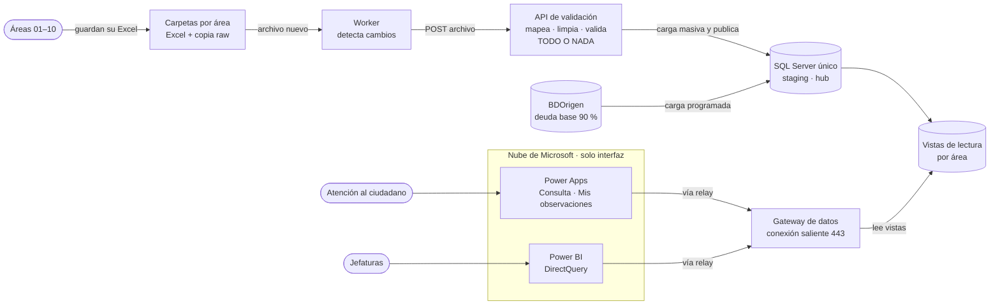

# Hub de Deuda — Informe para el equipo

Documento para que todo el equipo entienda la solución y pueda armar su parte de la presentación (o un PPT) con una referencia común.

**Material de referencia**

| Qué | Dónde |
|---|---|
| Diagrama de la arquitectura objetivo (Archify; botón «Exportar» → imagen o SVG para el PPT) | [arquitectura_objetivo-archify.html](arquitectura_objetivo-archify.html) |
| El mismo diagrama en PlantUML | [arquitectura_objetivo.puml](arquitectura_objetivo.puml) |
| Diagrama de lo que está desplegado hoy en Azure y Power Platform | [arquitectura-archify.html](arquitectura-archify.html) |
| Prueba de 500 000 filas | [PRUEBA_VOLUMEN.md](PRUEBA_VOLUMEN.md) |
| Detalle técnico, casos de uso, pruebas y decisiones | [DOCUMENTO_TECNICO.md](DOCUMENTO_TECNICO.md), [CASOS_DE_USO.md](CASOS_DE_USO.md), [PRUEBAS.md](PRUEBAS.md), [DECISIONES.md](DECISIONES.md) |

---

## 1. El problema

Una organización con **10 áreas** tiene entre 6 y 10 sistemas desconectados. Como TI nunca hizo las pantallas que las áreas necesitan, cada una lleva sus datos en **archivos Excel**, cada uno con otra estructura (de 10 a 50 columnas, con nombres distintos), sin validaciones y con errores de tipeo, duplicados y filas borradas. Los llenan contadores y abogados, que aplican a mano reglas complejas (prescripción, intereses, fraccionamientos).

El sistema formal guarda solo la **deuda base (≈ 90 %)**. El otro **10 %** (intereses, moras, embargos, fraccionamientos) vive solo en los Excel. Por eso, cuando un ciudadano pide su estado de cuenta, hay que preguntar área por área y **la respuesta tarda de 10 a 30 días**. Nadie se arriesga a cobrar de menos.

**El encargo:** como nuevo líder de TI, presentar una **prueba de concepto** rápida, barata y con poco margen de error. No se puede proponer un sistema integrado desde cero (6 a 12 meses).

## 2. La propuesta en una frase

> Los Excel de cada área se **validan, limpian y consolidan** en una base de datos **dentro de la empresa**; se suma a la deuda base y el saldo se consulta en segundos desde una app web y un tablero. **La nube solo es la interfaz y no guarda datos.**

**El saldo** de cada papeleta es: deuda base − pagos − descuentos + cargos (las anulaciones no cuentan).

## 3. Arquitectura objetivo

*(La versión de presentación está en el diagrama de Archify; en su botón «Exportar» se descarga como imagen para el PPT.)*

## 4. Los bloques, uno por uno

| Bloque | Responsabilidad | Se conecta con |
|---|---|---|
| **Áreas** | Registran pagos, cargos, descuentos e intereses en su Excel | Carpetas por área |
| **Carpetas por área** | Guardan el Excel con su formato actual y una copia **inmutable** (evidencia de auditoría) | Worker |
| **Worker** | Detecta archivos nuevos o modificados (por huella SHA-256) y los envía a validar | API de validación |
| **API de validación** | Tres pasos: **1)** mapea las columnas del área al modelo común, **2)** limpia y normaliza (DNI/RUC, fechas, montos), **3)** valida todas las filas. Decide **todo o nada** | SQL Server |
| **SQL Server único** | Única fuente de verdad. Staging, historial de cargas y observaciones. **Publica moviendo un puntero**, así el saldo cambia de una sola vez | Vistas de lectura |
| **BDOrigen** | Base del sistema institucional con la deuda base. **Solo se lee**, nunca se modifica | SQL Server |
| **Vistas de lectura** | Exponen solo consultas de lectura, una vista por área; sobre ellas leen las apps y el tablero | Gateway de datos |
| **Gateway de datos** | Agente de Windows instalado en el servidor de la empresa. Abre una conexión **saliente** (HTTPS 443) hacia Microsoft y por ahí atiende las consultas de la nube. SQL Server nunca se expone a internet | Power Apps, Power BI |
| **Power Apps (nube)** | Las apps ya construidas: *Consulta de deuda* (por papeleta, DNI/RUC o placa) y *Mis observaciones* (errores por área). Cambian su origen de datos a la base on-premise vía gateway. No guardan datos | Gateway de datos |
| **Power BI (nube)** | Tablero de gestión (deuda total, estado de cargas, calidad). DirectQuery vía el mismo gateway, sin copiar datos | Gateway de datos |

## 5. Decisiones de diseño y por qué

1. **Datos en la empresa, cómputo y orquestación en cualquier lado.** Es el lineamiento del profesor: los datos sensibles (DNI, placas, cuentas) no deben quedar guardados en la nube por políticas de seguridad y cumplimiento.
2. **«Todo o nada» por archivo.** Fraccionamientos y moras de una fila pueden depender de otra del mismo archivo; publicar una carga parcial llevaría a **cobrar de menos**, que es justo el riesgo del caso. Si hay un error, se rechaza el archivo completo y se devuelve la **lista completa de errores** para corregirlos de una vez.
3. **Una sola base, no tres instancias.** Repartir un archivo entre varias instancias rompería el «todo o nada» y daría lecturas inconsistentes. Si el volumen crece, se particiona **por área**, nunca un archivo entre instancias (fase 2).
4. **Las áreas no cambian su Excel.** Una tabla de mapeo traduce sus columnas al modelo común. Si cambian una columna, el archivo se rechaza hasta actualizar el mapeo (gobernanza del dato).
5. **Limpieza con rastro.** Cada corrección automática queda registrada (fila, campo, valor original, valor corregido).
6. **Las reglas complejas quedan fuera de la PoC.** Prescripción e intereses siguen en manos de contadores y abogados; el hub consolida lo que ellos determinan. Es la fase 2.

## 6. La conexión nube – empresa: el gateway de datos

Power Apps y Power BI corren en la nube de Microsoft; la base de datos está en la empresa. Una app en la nube no puede alcanzar un `localhost`, porque ese nombre apunta a su propio servidor. El **gateway de datos local** resuelve el problema:

1. Se instala en el equipo que tiene SQL Server (aquí, la laptop), con la cuenta Microsoft del dueño.
2. El gateway **abre una conexión saliente** hacia Microsoft (HTTPS 443 y puertos de Azure Service Bus) y la mantiene abierta. **No se abre ningún puerto de entrada** ni hace falta una IP fija.
3. En Power Apps se crea una conexión de SQL Server marcando «Conectar mediante un gateway de datos local». El nombre del servidor (por ejemplo `localhost\SQLEXPRESS`) **se resuelve desde el equipo del gateway**, no desde la nube.
4. Cuando la app consulta, la petición baja por esa conexión, se ejecuta en SQL Server y vuelve por el mismo camino. Los datos viajan cifrados y no se guardan en la nube.

**Requisitos:** el equipo del gateway debe estar encendido; SQL Express debe aceptar conexiones TCP/IP; el conector de SQL Server es Premium (el Developer Plan lo cubre); y instalar y registrar el gateway lo hace el dueño de la cuenta.

**Limitación a tener presente:** la conexión por gateway usa **una sola credencial** para todos los usuarios, así que SQL Server no sabe quién consulta. Los permisos por área se aplican en la app (cada área consume su vista). Para un control por usuario hace falta una API intermedia.

### Alternativas de conexión

| | Gateway de datos (elegida) | ngrok + API de lectura | VPN o Azure Relay |
|---|---|---|---|
| Para qué sirve | Power Apps y Power BI | PoC y demo rápida | Producción |
| Piezas nuevas | Solo instalar el agente | API de lectura, túnel y conector personalizado | Infraestructura de red |
| Seguridad | Buena, nativa de Microsoft; solo conexión saliente | Aceptable con autenticación; publica una URL y depende de un tercero | La más alta |
| Permisos por usuario | No (credencial única) | Sí, en la API | Sí |
| Tiempo de montaje | Menos de una hora | Horas | Días |

ngrok se descartó para la PoC porque publica una URL pública (justo lo que un banco o la SUNAT no aceptarían) y el plan gratuito cambia la URL al reiniciar. Si se usara, el `authtoken` es un secreto: va en una variable de entorno, nunca en el repositorio ni en el chat.

## 7. Qué ya funciona y qué falta

**Ya construido y probado (versión Azure + Power Platform):** circuito completo Excel → Power Automate → Blob → Function → Azure SQL → Power Apps, con lotes aceptados y rechazados, observaciones por fila, «Cargar ahora» y 17 pruebas automatizadas. Los saldos de demostración dan P0001 = 75. Detalle en [DOCUMENTO_TECNICO.md](DOCUMENTO_TECNICO.md).

**Probado para la versión on-premise (en tu laptop, SQL Server Express):** la validación y publicación con **500 000 filas**:

| Medición | Resultado |
|---|---|
| Validar, cargar y publicar 500 000 filas | 130 s (≈ 3 800 filas/s) |
| Fila 490 000 corrupta | Archivo **rechazado completo**, base sin cambios |
| Saldo de una papeleta | 188 ms |
| Memoria máxima | 2,5 GB |

**Falta construir para la versión on-premise:** carga masiva a staging con validación por conjunto, mapeo y normalización para las áreas, instalar el gateway, reconectar las dos apps de Power Apps a la base on-premise y pasar Power BI a DirectQuery. El código actual de validación sirve de especificación.

## 8. Reparto sugerido para la presentación

| # | Tema | Qué debe explicar |
|---|---|---|
| 1 | El caso y el objetivo | De 10 a 30 días a minutos; restricciones del líder de TI |
| 2 | Arquitectura general | El diagrama: qué queda en la empresa y qué en la nube |
| 3 | Seguridad y conexión | Datos on-premise, gateway con conexión saliente, vistas de solo lectura, permisos por área, alternativas (ngrok, VPN) |
| 4 | Ingesta y volumen | Carga masiva, validación, prueba de 500 000 filas |
| 5 | «Todo o nada» | Por qué, y la evidencia de la fila 490 000 |
| 6 | Excels heterogéneos | Mapeo de columnas por área |
| 7 | Limpieza y calidad | Normalización, registro de correcciones, códigos de error |
| 8 | Usuarios y apps | Power Apps ya construidas (consulta y observaciones), cambio de origen a on-premise, captura para el área de 238 000 registros |
| 9 | Demostración | Recorrido de un dato, de principio a fin |
| 10 | Alcance, costos y plan | Reglas complejas en fase 2, riesgos, plan a 30, 60 y 90 días |

**Sugerencias para el PPT:** una idea por lámina; usar la imagen exportada de Archify en las láminas 2 y 3; la tabla de volumen en la 4; el diagrama de lo desplegado en Azure para mostrar que ya hay una PoC funcionando.

## 9. Riesgos y límites

- **Memoria y tiempo de lectura del Excel:** el límite actual de 10 MiB debe ampliarse (el libro de 500 000 filas pesa 16 MiB) y la lectura con `openpyxl` consume unos 2,5 GB.
- **El gateway depende del equipo donde está instalado:** si se apaga, Power Apps y Power BI pierden la conexión.
- **Credencial única en el gateway:** los permisos por área se aplican en la app, no en SQL Server.
- **El servidor es una laptop:** si se apaga, nadie consulta. En producción sería un servidor real.
- **Alcance de la prueba de volumen:** un solo área y tres papeletas; no se probaron las 10 áreas a la vez.
- **Excels reales:** pueden tener más columnas, texto largo y fórmulas, y tardar más que el libro sintético.

## 10. Glosario rápido

- **PoC:** prueba de concepto, una versión mínima que demuestra que la idea funciona.
- **On-premise:** infraestructura propia de la empresa, no en la nube.
- **Staging:** tabla temporal donde se cargan los datos antes de publicarlos.
- **Puntero de publicación:** marca que indica qué carga está vigente; cambiarla publica todo de golpe.
- **Todo o nada:** una carga se publica completa o no se publica.
- **SHIR:** agente de Windows que permite a la nube leer una base interna sin abrir puertos.
- **Gateway de datos:** agente de Windows que permite a la nube consultar una base interna mediante una conexión saliente, sin abrir puertos.
- **ngrok:** servicio que crea un túnel HTTPS saliente para exponer un servicio interno; alternativa para PoC.
- **DirectQuery:** Power BI consulta la base en cada vista, sin guardar una copia de los datos.
