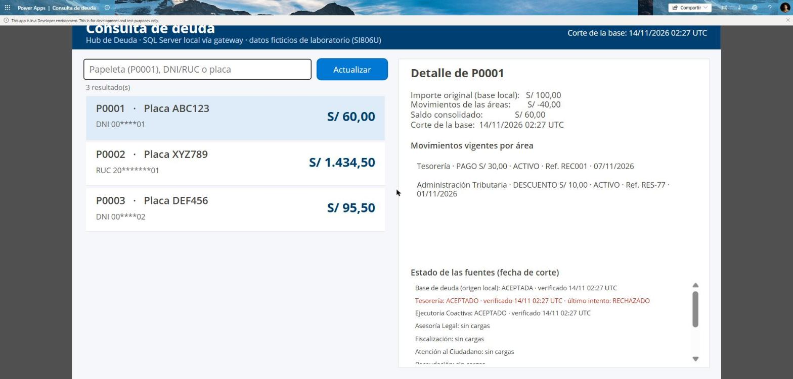
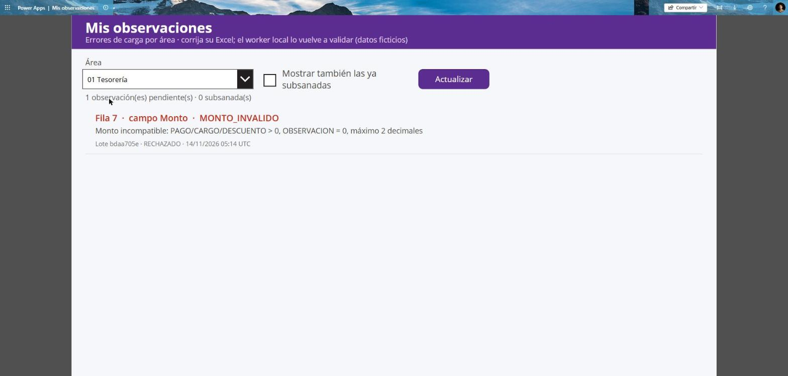
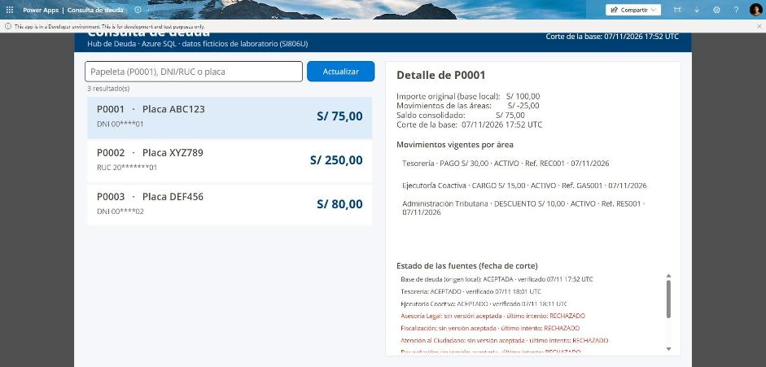
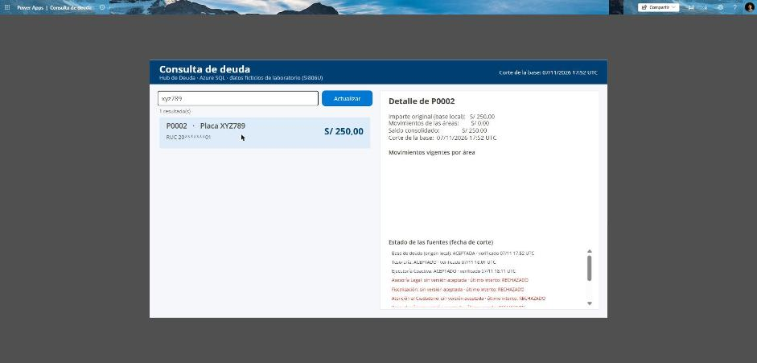
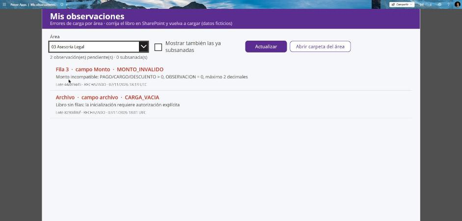
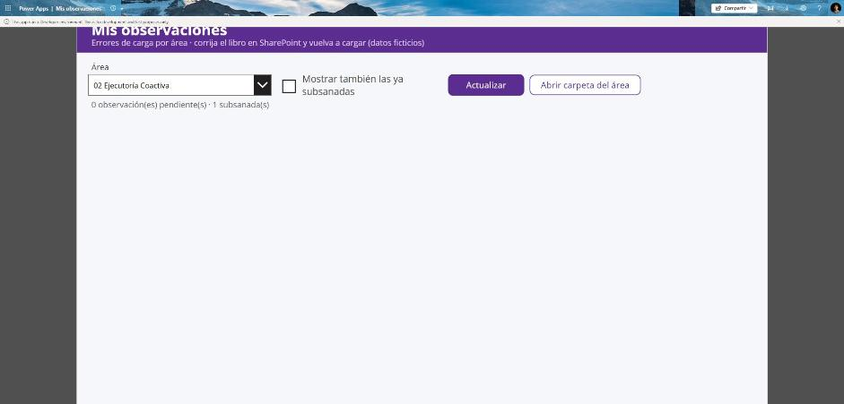

# Hub de Deuda — Informe final del proyecto

Curso SI806U · UNI · Estado al **14 de noviembre de 2026** · Todos los datos son **ficticios** (laboratorio).

Este documento reúne lo desarrollado: el problema, la arquitectura final (versión on-premise con gateway de datos), lo construido, las pruebas con sus resultados, las evidencias y los límites que quedan. Va acompañado del zip `Hub_de_Deuda_entrega.zip`, que contiene el código, las pruebas, los diagramas y las evidencias citadas aquí.

## 1. Resumen ejecutivo

- **Problema:** diez áreas llevan su parte de la deuda (≈ 10 %: intereses, moras, embargos, fraccionamientos) en Excel con formatos distintos. Obtener el estado de cuenta de un ciudadano tarda **10 a 30 días**.
- **Solución:** los Excel se traducen a un modelo común, se limpian con registro de cada corrección, se validan con la regla **«todo o nada»** y se publican en un **SQL Server dentro de la empresa**. Se suman a la deuda base (≈ 90 %) y el saldo se consulta en segundos desde Power Apps y Power BI. **La nube solo es la interfaz y no guarda datos.**
- **Resultados medidos:** un Excel «sucio» de **500 000 filas** llega publicado en **454 s (≈ 7,5 min)**; un error en la fila 490 000 rechaza el archivo completo sin tocar la base; un Excel corregido se ve en SQL **1,4 s** después de guardarlo (sondeo del worker cada 2 s).
- **Pruebas automáticas:** **23 aprobadas** y 2 pruebas de volumen opcionales (se activan a pedido).
- **Lo que falta:** mapeo de las otras 7 áreas, permisos por área dentro de la app, Power BI en DirectQuery, automatizar el worker como servicio y probar la caída del gateway.

## 2. El problema y el encargo

El sistema formal guarda solo la deuda base. El resto vive en Excel de cada área, llenados por contadores y abogados que aplican reglas complejas a mano. Cuando un ciudadano pide su estado de cuenta hay que preguntar área por área; nadie se arriesga a cobrar de menos.

**Encargo:** como líder de TI, presentar una prueba de concepto rápida, barata y con poco margen de error. No se propone un sistema integrado desde cero (6 a 12 meses).

**El saldo** de cada papeleta es: deuda base − pagos − descuentos + cargos (las anulaciones no cuentan).

## 3. Cómo evolucionó la solución

| Etapa | Qué se hizo | Resultado |
|---|---|---|
| 1. Versión Azure + Power Platform | Excel en SharePoint → Power Automate → Blob → Azure Function → Azure SQL → Power Apps | Circuito completo funcionando, 17 pruebas automáticas, pruebas T01–T15 |
| 2. Feedback del profesor | Datos sensibles deben quedar on-premise; la nube solo procesa y orquesta; 500 000 filas; definir «todo o nada» o «registro por registro»; limpieza y validación en el backend | Cambio de rumbo |
| 3. Versión on-premise | SQL Server Express local, worker, mapeo por área, saneamiento con registro, mismo validador | Circuito demostrado de punta a punta con 3 áreas |
| 4. Conexión nube–empresa | Gateway de datos local (se descartó ngrok); apps leyendo del SQL local | Apps publicadas y verificadas el 14 nov |
| 5. Pruebas de carga y latencia | 500 000 filas por el camino real; latencia Excel → dato visible | Resultados en la sección 8 |

## 4. Arquitectura final


*(El diagrama de presentación está en docs/arquitectura_objetivo-archify.html; su botón «Exportar» lo descarga como imagen.)*

| Bloque | Responsabilidad |
|---|---|
| **Carpetas por área** | Cada área deja su Excel con su formato; el sistema guarda el original y una copia normalizada **inmutable** (evidencia de auditoría) |
| **Worker** (`onprem/worker.py`) | Calcula la huella SHA-256; si el archivo cambió, lo traduce al contrato común, registra las correcciones y escribe el manifiesto al final |
| **Mapeo** (`onprem/mapeo.py`, `config_areas.json`) | Traduce las columnas propias de cada área (hoy áreas 1, 2 y 7) al modelo común; detecta el encabezado aunque no esté en la fila 1 |
| **Saneamiento** | Corrige espacios, mayúsculas, papeletas («p-1» → «P0001»), sinónimos, montos («S/ 1.234,50»), fechas (dd/mm/aaaa) y duplicados exactos; cada corrección se guarda en `dbo.CorreccionLote` |
| **Procesador** (`functions/procesador.py`) | El mismo código que la Function de Azure: valida **todas** las filas y publica el lote completo o lo rechaza completo con la lista de errores |
| **SQL Server único** | Staging, lotes, movimientos, observaciones. La publicación es atómica: se mueve un puntero (`Area.LoteVigente`) con `sp_getapplock` |
| **BDOrigen** | Deuda base, solo lectura |
| **Vistas de lectura** | `vDeuda`, `vMovimientoDetalle`, `vEstadoFuentes`, `vLoteCalidad`…; las apps y el tablero leen solo de aquí |
| **Gateway de datos** (`gw-hubdeudax`) | Agente de Windows con conexión **saliente** (HTTPS 443); no se abre ningún puerto de entrada |
| **Power Apps** | «Consulta de deuda» (por papeleta, DNI/RUC o placa) y «Mis observaciones» (errores por área) |
| **Power BI** | Tablero de gestión por DirectQuery (pendiente de conectar) |

## 5. Dos decisiones de diseño

**Todo o nada por archivo.** Los fraccionamientos y las moras de una fila pueden depender de otra del mismo archivo. Publicar una carga parcial llevaría a **cobrar de menos**, que es el riesgo del caso. Por eso un error rechaza el archivo completo y devuelve la **lista completa de errores** para corregirlos de una vez. El registro por registro sería más rápido, pero deja saldos inconsistentes.

**Una sola base.** Repartir un archivo entre varias instancias rompería el «todo o nada» y daría lecturas inconsistentes. Si el volumen crece, se particiona por área, nunca un archivo entre instancias.

## 6. La conexión nube–empresa

Power Apps corre en la nube de Microsoft y no puede alcanzar un `localhost`. El gateway resuelve esto: abre una conexión saliente hacia Microsoft y por ahí atiende las consultas. SQL Server nunca se expone a internet.

Puesta en marcha (en orden):

1. Activar TCP/IP en SQL Express, puerto 1433 (`tools/onprem_preparar_sql.ps1`, como administrador).
2. Instalar el gateway en modo estándar y registrarlo **en la misma región que el entorno de Power Apps** (South America).
3. Crear la cuenta local `svc_hubdeuda`, sin privilegios, y darle solo lectura sobre las vistas (`tools/onprem_gateway_acceso.py`).
4. En Power Apps, crear la conexión SQL Server con gateway: servidor `localhost,1433`, base `HubDeuda_dev`, autenticación Windows.
5. Cambiar el origen de datos de las dos apps y publicarlas (`tools/publicar_apps.ps1`).

**Lecciones:** el gateway solo aparece en entornos de su misma región (hubo que reinstalarlo); la conexión usa una cuenta de Windows con contraseña, no la del servicio; la contraseña de `svc_hubdeuda` debe configurarse para que no caduque; al reimportar la solución cada app pide otra vez la autorización de la conexión.

## 7. Seguridad

- Los datos sensibles **no salen de la empresa**: la nube solo recibe el resultado de cada consulta.
- Ninguna contraseña ni llave pasó por el chat ni está en el repositorio; los archivos con datos de cuenta están fuera de git.
- La cuenta del gateway tiene **solo lectura sobre las vistas** (ninguna tabla ni escritura); la prueba T12 verifica el aislamiento por área en SQL.
- **Limitación real:** con el gateway todos los usuarios consultan con una sola identidad, así que SQL Server no distingue áreas. Hoy cualquier usuario podría elegir otra área en el desplegable de «Mis observaciones». Hay dos salidas: filtrar por usuario en la app (hasta que haya una API intermedia) o declarar la limitación.

## 8. Pruebas y resultados

### 8.1 Pruebas automáticas

**23 aprobadas, 2 omitidas** (las de volumen, opcionales). Cubren: T01–T12 del circuito (base, pago, duplicado, error, corrección, cargo, descuento, anulación, borrado, orden, caída, aislamiento), calidad de datos, permisos mínimos, mapeo de 3 áreas con formatos distintos, «todo o nada» on-premise y latencia. Las pruebas T13 y T14 (SHIR detenido y frescura) dependen de Azure y Power Apps y se verificaron a mano.

### 8.2 Volumen: 500 000 filas por el camino real

Excel «sucio» del área 1 (otros encabezados, fechas como texto, papeletas mal escritas, sinónimos), pasado por el worker.

| Etapa | Resultado |
|---|---|
| Mapeo y saneamiento | 147 s · 1 583 333 correcciones registradas |
| Validar todas las filas, cargar y publicar | 88 s · ACEPTADO · 500 000 movimientos |
| Registrar las correcciones en SQL | 219 s |
| **Total Excel sucio → publicado** | **454 s (≈ 7,5 min)** |
| Memoria máxima del proceso | 2,6 GB |
| Saldo de una papeleta / detalle de 20 movimientos | 159 ms / 7 ms |
| Reenvío con «treinta soles» en la fila 490 000 | **RECHAZADO**, `MONTO_INVALIDO` en la fila 490 000; la base queda igual |

**Hallazgo:** la primera ejecución no terminó. Enviar ~1,6 M de correcciones en una sola llamada dejaba a SQL Server más de 79 min sin acabar; insertando por tandas de 20 000 filas el ritmo es de unas 8 000 filas/s. Quedó corregido en el worker.

### 8.3 Latencia: del Excel al dato visible

El worker corre con un sondeo fijo (`--cada N`). Se guarda un Excel con error y luego el corregido, y se mide cuánto tarda en verse el resultado en SQL.

| Sondeo del worker | Excel con error → observación visible | Excel corregido → saldo correcto visible |
|---|---|---|
| Cada 2 s | 1,8 s | **1,4 s** |
| Cada 10 s | 10,3 s | **9,2 s** |

La latencia es la espera del siguiente sondeo más el proceso (menos de 1 s para el libro de demostración). **No se midió** la última parte: el tiempo que la app tarda en refrescar y traer el dato por el gateway.

## 9. Evidencias













Evidencias en texto (dentro de la carpeta `evidencias/` del zip):

| Archivo | Qué demuestra |
|---|---|
| `2026-11-14_prueba-volumen-worker-500000.txt` | Tiempos y memoria de la prueba de 500 000 filas |
| `2026-11-14_prueba-latencia.json` | Mediciones de latencia por intervalo de sondeo |
| `2026-11-14_pytest-resumen.txt` | 23 pruebas aprobadas, 2 omitidas |
| `2026-11-14_sql-local-estado.txt` | Saldos, lotes, correcciones y permisos de solo lectura en `HubDeuda_dev` |

Saldos de la demostración on-premise: **P0001 = 60,00 · P0002 = 1 434,50 · P0003 = 95,50**, con 3 lotes aceptados, 1 rechazado (Tesorería, fila 7, `MONTO_INVALIDO`) y 48 correcciones de saneamiento registradas.

## 10. Límites conocidos y riesgos

| Tema | Situación |
|---|---|
| Permisos por área | No aplicados con una sola credencial (sección 7) |
| Mapeo | Solo 3 de las 10 áreas |
| Worker y carga de BDOrigen | Se ejecutan a mano; falta convertirlos en servicio o tarea programada |
| Memoria | 2,6 GB de pico con 500 000 filas; el equipo necesita unos 8 GB libres |
| Registro de correcciones | Con datos muy sucios genera ~3 filas por fila; definir cuánto tiempo se conserva |
| Gateway | Depende de que el equipo esté encendido; si se apaga, las apps pierden la conexión (no probado) |
| Servidor | Es una laptop; en producción sería un servidor real |
| Excel reales | Pueden traer fórmulas, varias hojas o archivos bloqueados por Excel; no se probaron |
| Concurrencia | No se probó con varias áreas cargando a la vez |
| Power BI | Pendiente conectar en DirectQuery |
| Flujos de Azure | Siguen encendidos; decidir si se apagan |

**Licencias** (fuentes secundarias, a confirmar con Microsoft): el conector de SQL Server es premium. Power Apps Premium ronda USD 20 por usuario al mes (12 desde 2 000 usuarios), o unos 10 con pago por uso; Power BI Pro, 14. El Developer Plan usado en el laboratorio lo cubre solo para desarrollo.

## 11. Próximos pasos

1. Mapear las 7 áreas restantes (una entrada más en `config_areas.json` por área).
2. Decidir los permisos por área: filtro por usuario en la app o API intermedia.
3. Convertir el worker y la carga de BDOrigen en tareas programadas.
4. Probar la caída del gateway y la concurrencia entre áreas.
5. Conectar Power BI por DirectQuery.
6. Probar con Excel reales de las áreas.

## 12. Cómo reproducirlo

```powershell
.venv\Scripts\python.exe tools\aplicar_sql.py --carpeta sql\hub --db HubDeuda_dev
.venv\Scripts\python.exe tools\cargar_base_local.py --hub HubDeuda_dev
.venv\Scripts\python.exe onprem\worker.py --registrar
.venv\Scripts\python.exe onprem\datos_demo.py
.venv\Scripts\python.exe onprem\worker.py --cada 5
.venv\Scripts\python.exe -m pytest tests -q
$env:HUB_VOLUMEN="500000"; .venv\Scripts\python.exe -m pytest tests\test_volumen_worker.py -s
```

## 13. Referencias dentro del zip

| Carpeta o archivo | Contenido |
|---|---|
| `docs/INFORME_FINAL.docx` | Este informe |
| `docs/ONPREM.md` | Estado, comandos y lecciones de la versión on-premise |
| `docs/PRUEBA_VOLUMEN.md` | Pruebas de 500 000 filas (contrato v1 y camino real) |
| `docs/arquitectura_objetivo-archify.html` | Diagrama de la arquitectura objetivo |
| `docs/DOCUMENTO_TECNICO.md`, `CASOS_DE_USO.md`, `PRUEBAS.md`, `DECISIONES.md` | Detalle técnico, casos de uso, catálogo T01–T15 y decisiones |
| `onprem/`, `functions/`, `sql/`, `tools/`, `tests/` | Código del worker, mapeo, validador, migraciones SQL, herramientas y pruebas |
| `powerplatform/`, `powerbi/` | Paquetes de las apps, flujos y el modelo de Power BI |
| `evidencias/` | Capturas y resultados de pruebas |
